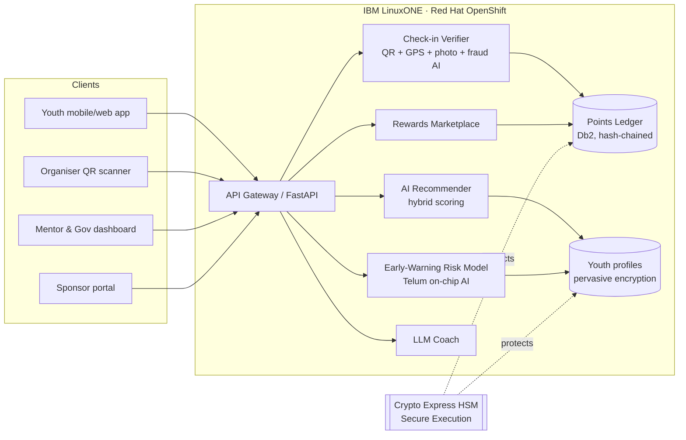

# YouthQuest AI — Architecture

## Request flow
1. Youth opens app → `GET /youth/{id}/recommendations` → recommender ranks quests (interest 40%, new skills 20%, locality 15%, peers 15%, novelty 10%) with a plain-language "why".
2. At the venue, organiser QR is scanned → `POST /checkin` → verifier validates → ledger credits XP idempotently (duplicate scans ignored) → level, badges, streak, leaderboard update instantly.
3. Youth spends points → `POST /redeem` → atomic debit with balance check (no double-spend) → voucher code issued; sponsor stock decremented.
4. Every activity event re-scores the risk model; `GET /admin/at-risk` gives mentors a ranked list with suggested actions.

## IBM Z / LinuxONE mapping
| Need | IBM Z capability |
|---|---|
| Protect youth (incl. minors) data | Pervasive encryption, Secure Execution, Crypto Express HSM |
| Instant risk + recommendation scoring | Telum on-chip AI accelerator (in-transaction inference) |
| Fraud-proof rewards ledger | Db2 ACID transactions + hash chain audit |
| National-scale peaks | OpenShift on LinuxONE, horizontal autoscaling, high availability |
| Sustainability | Workload consolidation, lower energy per transaction |
